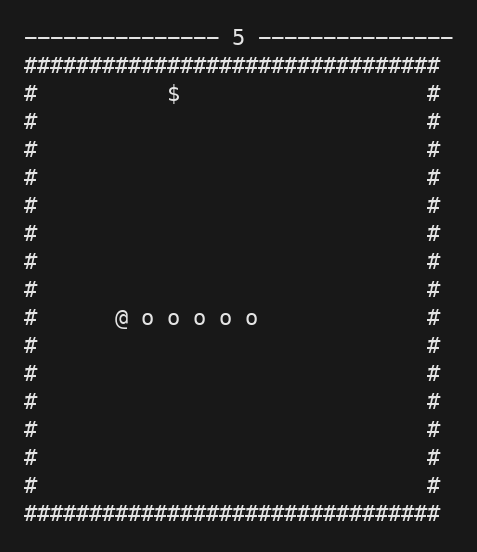
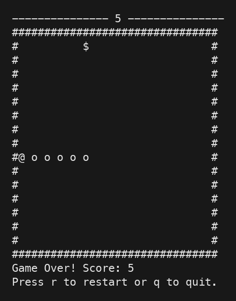

# terminal-snake

Snake in the terminal, written in C++. I made this to learn how game loops,
keyboard input and redrawing frames work without a game engine.

It uses `termios` for input and ANSI escape codes to move the cursor. No ncurses.

## what it looks like





These images are rendered from the actual program's terminal output.

## running it

Tested on macOS. It uses POSIX terminal APIs, so it isn't Windows-compatible
as-is. Linux should work too, but I haven't tested it there.

You need a C++17 compiler. From the project folder:

```sh
clang++ -std=c++17 -Wall -Wextra -pedantic snake.cpp -o snake
./snake
```

Run it in a terminal, not the VS Code output panel. Give it at least 40 columns
and 26 rows so the board and game-over message fit.

## controls

- `w`, `a`, `s`, `d` to move
- `p` to pause / resume
- `q` to quit
- `r` to restart after dying

Use lowercase keys. `@` is the head, `o` is the body, and `$` is food.
Eating grows the snake and adds one point. Hitting a wall or your body ends the game.

## the basic idea

The snake is a deque of row/column pairs. Each move adds a new head and removes
the tail, unless food was eaten. A string grid is printed over the previous frame.
Cells have a space after them because terminal characters aren't square.

The game moves five times a second. Extra buffered keys are discarded so spamming
doesn't queue up a long sequence of turns.

## still rough

- Apple spawning needs a better check so food never lands inside the snake.
- The random generator isn't seeded yet, so the sequence repeats between runs.
- No arrow keys or terminal-resize handling.
- Quit with `q` so terminal settings get restored. If you use Ctrl+C and your
  typing becomes invisible, type `reset` and press Enter.

Next cleanup is splitting input, updating and drawing into separate functions.

License is in [LICENSE](LICENSE).
